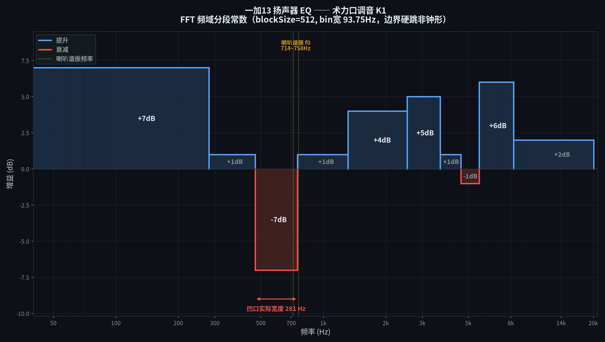

# 一加13 扬声器音效

一个 KernelSU / Magisk 模块，给一加13 的双扬声器做全局调音。

**装完重启即用，改配置 1 秒生效，不需要装 APK。**



---

## 模块并非随手拉了个 EQ

### 实测一：两颗喇叭的原始衰减量不一样

一加13 的功放芯片（AW88461，两颗分别推上扬和下扬）里，
寄存器 `0x05` 的低 10 位存的是**衰减量**。实测原始值：

| 喇叭 | 寄存器值 | 低 10 位（衰减量） |
|---|---|---|
| 上扬（顶部） | `0xc040` | **64** |
| 下扬（底部） | `0xc030` | **48** |

两颗喇叭出厂就不是同一个衰减量，下扬比上扬少衰减 16 档。

### 实测二：数字越小，声音越大

```
衰减量 0    → 最大音量
衰减量 48   → 原厂下扬的水平
衰减量 64   → 原厂上扬的水平
衰减量 1023 → 完全静音
```

把它拉到 1023 时，那颗喇叭会**彻底闭嘴**（只剩另一颗在响）——
这一点可以直接听出来，不是推理出来的。

**所以「往上加数字」等于「把声音调小」。** 想让某颗喇叭更响，是把数字改小。

### 实测三（纯主观）：喇叭的谐振点在 714~758 Hz

芯片能直接读出喇叭的谐振频率 f0：

```
上扬 758 Hz    下扬 714 Hz
```

这个位置：它正好卡在**人声基频的下沿**和**低频乐器基频的上沿**之间。
两边的能量在这里撞车、互相掩蔽，听感上就是「糊」「分不开」「杂糅」。

**这也是为什么单纯把低频拉高没用**——拉的是 200 Hz，糊在 700 Hz，越拉越糊。

### 这三条实测决定了（主观）曲线怎么画

| 实测发现 | 曲线上对应的处理 |
|---|---|
| f0 = 714~758 Hz 是掩蔽区 | **削掉 469~750 Hz（−7 dB）**，把糊的根源挖掉 |
| 挖掉后会显得单薄 | 补 200 Hz 低频冲击、补 1.2~3.6 kHz 人声主体 |
| 空隙会导致「脱节」 | 在 **4500 Hz 补 1 dB** 衔接中高频（这是最容易漏掉的一段） |
| 虚拟歌姬/女声的齿音在 5~9 kHz | 抬 8115 Hz 做亮度，5.6 kHz 稍压防刺耳 |

其余所有参数都可以自己改，不绑定任何曲风。

> **说明：本模块不写功放寄存器。**
> 上面三条实测只用来决定 EQ 曲线怎么画，运行时不碰 `0x05`。
> 直接改寄存器也能调音量，但那是另一条路（需要开机脚本，且两颗喇叭的 ACF
> 各自独立，风险更高），不在本模块范围内。

---

## 默认曲线

| 生效范围 | 增益 | 作用 |
|---|---|---|
| 0 ~ 281 Hz | +7 dB | 鼓点冲击、低频厚度 |
| 281 ~ 469 Hz | +1 dB | 低频到中频的过渡 |
| 469 ~ 750 Hz | **−7 dB** | **掩蔽区（喇叭 f0 就在这），治糊** |
| 750 ~ 1312 Hz | +1 dB | 中频身体感 |
| 1312 ~ 2531 Hz | +4 dB | 人声存在感 |
| 2531 ~ 3656 Hz | +5 dB | 咬字清晰度 |
| 3656 ~ 4594 Hz | +1 dB | 中高频衔接（补空隙） |
| 4594 ~ 5625 Hz | −1 dB | 压一点防刺耳 |
| 5625 ~ 8250 Hz | +6 dB | 亮度 |
| 8250 ~ 20062 Hz | +2 dB | 空气感 |

> 表里的边界是**实际生效的边界**，不是滤波器中心频率。
> 具体机制见下面的「它是怎么工作的」。

---

## 它是怎么工作的

用的是 Android 自带的 `DynamicsProcessing` 音效，挂在**全局混音输出**上，
所以所有 App 的声音都会经过它。


```
FFT 把声音切成频谱 → 每一段乘一个固定增益 → IFFT 变回声音
```

这带来三个必须知道的特点：

- **最小可控宽度 = 93.75 Hz**（48000 ÷ 512），比这更窄的调整做不到
- 段与段之间是**台阶状硬跳变**，没有平滑过渡
- **没有 Q 值**这个参数，宽度由频点间距决定

---

## 安装

1. 从 [Releases](../../releases) 下载最新的 zip
2. KernelSU / Magisk → 模块 → 从本地安装
3. 重启

**要求：**

- 一加13（PJZ110）
- KernelSU 或 Magisk（需要 root）
- Android 14 以上
- **装之前先卸掉其他音效模块**（全局混音层只能挂一个音效）

---

## 改曲线

```bash
su
vi /data/adb/spk-eq/conf
```

一行一个频点，格式 `频率Hz:增益dB`，最多 14 行，`#` 开头是注释。

```
200:7
420:1
650:-7
1200:1
2400:4
3600:5
4500:1
5500:-1
8115:6
20000:2
```

存盘后 **1 秒内自动生效**，不用重启、不用重启服务。服务每 200 ms 读一次这个文件。

### 可选：多段压缩（改善分离度）

EQ 是**静态曲线**，只会整体抬降，没法把已经糊在一起的声音分层。
这时候用多段压缩，让每个频段各自动态工作——响的自动压下去，轻的浮上来。

```bash
vi /data/adb/spk-eq/mbc
```

一行一个频段：`频率Hz:阈值dB:压缩比:启动ms:释放ms`

```
220:-18:4:8:90
800:-22:4:8:90
3000:-24:4:6:70
8000:-26:3:5:60
```

留空 = 关闭。

### 可选：限幅器阈值

```bash
vi /data/adb/spk-eq/limiter
```

一个数字（dB）。默认 `-1`，写 `-99` 表示关闭。

### 重启服务

模块卡片上点「执行」按钮，或者：

```bash
su -c "sh /data/adb/modules/spk_eq_master/action.sh"
```

---

## 卸载

KernelSU / Magisk → 模块 → 移除 → 重启。

配置在 `/data/adb/spk-eq/`，卸载脚本会自动清理。

---

## 文件都在哪

```
/data/adb/spk-eq/
├── conf           EQ 曲线（主要改这个）
├── mbc            多段压缩（可选）
├── limiter        限幅阈值（可选）
├── boot.log       开机启动日志
└── service.log    运行日志，每次应用配置都会写一条
```

---


## 常见问题

**装了没效果？**

先看服务在不在跑：

```bash
su -c "ps -A | grep DynEqService"
su -c "tail -20 /data/adb/spk-eq/service.log"
su -c "cat /data/adb/spk-eq/boot.log"
```

`service.log` 里能看到 `APPLY ...` 就是正常工作了。

**会和别的音效模块打架吗？**

会。全局混音层只能挂一个音效，装之前先卸掉其他的。

**会不会把喇叭搞坏？**

默认曲线最大提升 +7 dB，后面跟着常开的限幅器（−1 dB）。
长期用没发现问题，但**任何 EQ 模块都有风险**，自己判断。

**能让只某个 App 生效吗？**

不行，这是全局的。

**别的机型能用吗？**

代码是通用的（`DynamicsProcessing` 是 AOSP 的公开 API）。
但默认曲线是照着一加13 实测调的。换机型建议先量出那台机器的喇叭 f0，再重新画曲线。

---

## 用到的技术

- `DynamicsProcessing`（AOSP `libeffects`，Apache-2.0）
- FFT 频域处理，`blockSize = 512`，bin 宽 93.75 Hz
- `app_process` 直接跑 dex，不需要常驻 APK
- KernelSU 模块框架

---

## 免责声明

改系统音频输出有风险。用之前确认自己有刷机和救砖的能力。
作者不对任何设备损坏负责。

---

## License

[MIT](LICENSE) © 2026 600斤的立子
